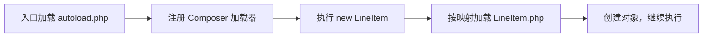

# PHP 后台开发学习手册

目标：从自己运行 PHP，逐步学会读取输入、验证规则、保存数据、限制权限，最后独立给商品接口加详情和筛选。使用 PHP 8.4、MySQL、ThinkPHP 与仓库自带 Vue 页面；假定你已有 JavaScript/Vue 基础。

**这是唯一学习入口。** 每次完成一个学习单元，再做它末尾的变化题。预计一次 45–90 分钟；以能解释和修改为准，不按天赶进度。

## 总览：按这条路线学习

单元号直接使用源码目录号：`02.3` 表示 `02-oop-composer` 的第三个学习单元。目录按主题命名，实际阅读顺序如下；每个单元都会给出确切文件和运行入口。

| 阅读顺序 | 本段结果 | 单元与对应目录 |
| --- | --- | --- |
| 起步 | 运行自己的 PHP 文件 | [00 环境](#start) · [源码索引](../stages/00-environment/README.md) |
| 语法 | 用函数、数组和文件表达规则 | [01 基础](#basics) · [源码索引](../stages/01-php-syntax/README.md) |
| 对象 | 理解跨文件调用和自动加载 | [02 对象与 Composer](#price-object) · [源码索引](../stages/02-oop-composer/README.md) |
| 请求 | 分清终端输出、HTML 和 JSON 响应 | [03 HTTP](#http-data) · [源码索引](../stages/03-web-security/README.md) |
| 数据 | 绑定查询，再返回真实商品 | [04 数据库](#database-basics) · [源码索引](../stages/04-data-storage/README.md) |
| 检查 | 给自己的规则写测试 | [05 测试](#checkpoint-debug) · [源码索引](../stages/05-engineering/README.md) |
| 框架与接口 | 跟通已有接口，独立补详情 | [07 框架 / 08 商品接口](#product-api) · [07](../stages/07-thinkphp-foundation/README.md) / [08](../stages/08-thinkphp-admin-api/README.md) |
| 页面 | 从浏览器追踪数据与权限 | [06 Vue 联调](#vue) · [源码索引](../stages/06-linux-frontend/README.md) |
| 独立交付 | 自己实现筛选，验证与恢复 | [09 综合练习](#delivery) · [源码索引](../stages/09-admin-capstone/README.md) |

04.3/04.4 的索引与事务在最后一段再学；02.4 的折扣组合是选读。Magento 是第二阶段。先后顺序由这张表和段末“下一步”确定。

<a id="learning-method"></a>

### 文件约定与学习方法

- `examples/`：本手册的稳定参考，先读、预测和运行。编号在各目录内连续。
- `exercises/`：你的练习与已有实验。旧的编号文件仍保留，不再当作标准答案；本手册只把 examples 中的文件称为参考。
- `src/`：被入口调用的类；`public/`：浏览器访问的入口；`tests/`：根目录下的自动测试。这些文件按职责命名。
- 自己的文件统一用 `my-*`；已存在就继续使用，不覆盖。新建练习只写本节内容，不必把整套参考项目复制一遍。

每节按“预测 → 运行 → 观察 → 改一个条件 → 解释”进行。遇到失败先保存输入、预期、实际与定位证据。反复问：输入从哪里来？谁调用谁？结果去了哪里？数据与权限由谁保证？

各段末的完成记录是唯一进度记录。填日期、自己的文件或观察结果；`—` 表示未完成。运行参考检查不代表独立掌握。下一次学习先重做上一段的一个变化题。

所有 PowerShell 命令都在 **learn-php 根目录**执行，命令前的 `#` 是解释。传给容器的文件路径用 `/`，不传 Windows 的 `E:\...` 路径。单元表中的“自己写”文件由你创建，因此可能尚不存在。

<a id="start"></a>
<a id="environment"></a>

## 00 · 准备环境，运行文件

### 开始前：首次准备一次

打开 Docker Desktop，等引擎就绪。首次执行下面脚本，它会安装锁定依赖、补缺少的学习表和示例数据，并启动完整主线。已有配置与记录保留；重复执行仍可能补回删掉的种子，不作为日常启动命令。

```powershell
# -File 指定仓库脚本；Bypass 只放宽本次 PowerShell 进程的脚本执行策略
powershell -ExecutionPolicy Bypass -File scripts/setup-thinkphp.ps1
```

只运行信任的脚本。首次下载可能较慢；成功后显示网页、后端和 Vue 地址。之后每次学习只用：

```powershell
# 创建或更新并启动主线；-d 后台运行，--wait 等待服务运行或健康
docker compose up -d --wait
# 查看状态：PHP 工具应运行，其余主线服务应为 healthy
docker compose ps
```

主线是 php、mysql、web、thinkphp、frontend。Magento 使用独立项目，此时不需要它。失败先看[环境排错](#troubleshooting)，不清空数据卷。

<a id="unit-00-1"></a>

### 00.1 · 从文件到终端输出

| 先读并运行 | 自己写 | 完成信号 |
| --- | --- | --- |
| [01-hello.php](../stages/00-environment/examples/01-hello.php) | `stages/00-environment/exercises/my-hello.php` | 自己的名称出现在终端 |

先预测问候文字，再运行。Docker 镜像提供环境，容器是运行实例；本机源码与容器 `/workspace` 共享，改 PHP 不需重建镜像。

```powershell
# exec 在运行中的容器执行；第一个 php 是服务名，第二个是 PHP 程序
docker compose exec php php stages/00-environment/examples/01-hello.php
```

应看到问候与 PHP 8.4 系列版本。创建上表练习目录和文件，写：

```php
<?php
// $ 声明变量名，= 赋值；; 结束普通语句。
$name = 'Lin';
// echo 输出；双引号插入变量，{} 划清名字边界，\n 换行。
echo "Hello, {$name}\n";
```

```powershell
# 执行自己的文件，应输出 Hello, Lin
docker compose exec php php stages/00-environment/exercises/my-hello.php
```

`<?php` 进入 PHP，`//` 是注释，纯 PHP 通常省略结束标记。如果原来把 my-hello.php 放在阶段根目录，可以继续用原路径，不必复制已有作业。

**自己试：** 不看参考，输出一个商品名称和整数价格。故意拼错自己的变量名，读提示再修复；分清路径错误、语法错误和 Docker 未运行。

| 完成记录 | 证据 |
| --- | --- |
| 跟做：自己的问候文件运行成功 | — |
| 独立：重写两行并解释变量、输出和路径 | — |
| 排错与下次变式：读到错误并修复；下次输出两件商品 | — |

下一步：[01.1](#unit-01-1)。

<a id="basics"></a>

## 01 · 函数、数组与文件

本段先把业务写成普通 PHP，再进入对象。前置：00.1 能执行自己的文件。表中每个单元号与本目录参考编号对应；01.7 是综合独立题。

| 单元 | 参考入口 | 自己写 | 观察结果 |
| --- | --- | --- | --- |
| [01.1 变量](#unit-01-1) | [01-variables.php](../stages/01-php-syntax/examples/01-variables.php) | my-variables.php | 类型与文字 |
| [01.2 判断和循环](#unit-01-2) | [02-control-flow.php](../stages/01-php-syntax/examples/02-control-flow.php) | my-rules.php | 小计、运费 |
| [01.3 函数与异常](#unit-01-3) | [03-functions-exceptions.php](../stages/01-php-syntax/examples/03-functions-exceptions.php) | my-quantity.php | 返回结果或错误 |
| [01.4 数组与回调](#unit-01-4) | [04-arrays-json.php](../stages/01-php-syntax/examples/04-arrays-json.php) | my-arrays.php | 三种数组变化 |
| [01.5 文件与 JSON](#unit-01-5) | [05-files-json.php](../stages/01-php-syntax/examples/05-files-json.php) | my-json.php、my-products.json | 正常读取与三类失败 |
| [01.6 组合已有知识](#unit-01-6) | [06-order-total.php](../stages/01-php-syntax/examples/06-order-total.php) | my-total.php | 整数金额计算 |
| [01.7 验证价格](#unit-01-7) | 自己实现，不提供答案 | my-price.php、my-price-check.php | 四类输入的结果 |

自己的文件均放在 `stages/01-php-syntax/exercises/`。先读 examples，不要求把已有 exercises 中的调试实验恢复成参考。

<a id="variables-control-flow"></a>
<a id="unit-01-1"></a>

### 01.1 · 值与类型

打开表中的 01-variables.php，找赋值、拼接和输出。`int` 是整数，`string` 是字符串，`bool` 只有 true/false。金额用整数“分”，显示时再换成元。

```powershell
# 运行变量参考，预期 Notebook: 9900 和 bool(true)
docker compose exec php php stages/01-php-syntax/examples/01-variables.php
```

`echo` 不自动换行，`PHP_EOL` 是换行常量。`var_dump` 显示类型和值；`declare(strict_types=1)` 限制标量类型转换，不验证价格正负。

**自己试：** 在 my-variables.php 定义 `'9900'` 和 `9900`，用 var_dump 比较；再输出自己的商品。

```powershell
# 运行自己的变量实验，确认一个是 string、一个是 int
docker compose exec php php stages/01-php-syntax/exercises/my-variables.php
```

完成：能解释“看起来一样的数字”为什么类型不同。下一步：[01.2](#unit-01-2)。

<a id="unit-01-2"></a>

### 01.2 · 累加与分支

读 02-control-flow.php。`foreach` 每次取一个价格，`+=` 累加；`条件 ? A : B` 只选择一个结果。这里满 29900 分免运费。

```powershell
# 先预测再执行：小计 14900，运费 2000；两个比较结果为 false、true
docker compose exec php php stages/01-php-syntax/examples/02-control-flow.php
```

**自己试：** 在 my-rules.php 写两件商品的小计与运费。分别用空列表、小计 29899、小计 29900，预测再运行。`===` 同时比较类型和值。

```powershell
# 检查自己三次输入：空列表小计 0；门槛两侧运费分别 2000、0
docker compose exec php php stages/01-php-syntax/exercises/my-rules.php
```

完成：能逐轮解释小计变化，并解释“刚好等于门槛”走哪个分支。下一步：[01.3](#unit-01-3)。

<a id="functions-exceptions"></a>
<a id="unit-01-3"></a>

### 01.3 · 函数返回与失败

按顺序读 [shipping.php](../stages/01-php-syntax/examples/support/shipping.php) 的函数，再读 03-functions-exceptions.php 的调用。`int $subtotalMinor` 是输入类型，`: int` 是返回类型；return 把结果交给调用处，echo 才输出。require_once 先执行定义文件，02.2 会专门练习它。

```powershell
# 依次应为 2000、0、Subtotal must be non-negative
docker compose exec php php stages/01-php-syntax/examples/03-functions-exceptions.php
```

`throw new InvalidArgumentException(...)` 抛出输入错误；try/catch 让调用处处理它，未捕获的异常会结束脚本。`$error->getMessage()` 读取错误文字。

**自己试：** 在 my-quantity.php 定义 `readQuantity(int $quantity): int`，只接受至少 1 件。文件末尾调用 1、2，再用 try/catch 调用 0；正常返回原数量，0 输出自己的错误提示。

```powershell
# 运行自己的数量函数，核对 1、2 和错误提示
docker compose exec php php stages/01-php-syntax/exercises/my-quantity.php
```

完成：能说明 return、echo、throw 各自改变什么。下一步：[01.4](#unit-01-4)。

<a id="arrays-files-json"></a>
<a id="unit-01-4"></a>

### 01.4 · 筛选、重排、变换

读 04-arrays-json.php，按三个输出逐步看数组。`['sku' => 'BOOK']` 是键值，`$p['sku']` 取值。回调是传给另一个函数的函数；`fn (array $p): bool => ...` 接收一项数组，自动返回表达式。

```powershell
# 观察 Filtered、List、SKUs 三行，而不只看最终结果
docker compose exec php php stages/01-php-syntax/examples/04-arrays-json.php
```

| 操作 | 输入与作用 | 本例输出要点 |
| --- | --- | --- |
| array_filter | 数组、判断回调；筛选并保留原键 | BOOK 的键仍为 1 |
| array_values | 只接收数组；重排数字键，不接收回调 | JSON 变成以 [ 开始的列表 |
| array_map | 变换回调、数组；逐项产生新值 | 得到 ["BOOK"] |

JSON 是文本，PHP 数组是程序里的值；json_encode 才把数组变成文本。`JSON_THROW_ON_ERROR` 让编码失败抛异常。

**自己试：** 新建 my-arrays.php，保留两个商品但把门槛改成 2500，预测每一步；再把其中一个 fn 改成普通匿名函数 `function (array $p): bool { return ...; }`。它没有函数名，由接收它的函数调用。

```powershell
# 两件商品都应保留，SKUs 应包含 CABLE 和 BOOK；改写前后结果相同
docker compose exec php php stages/01-php-syntax/exercises/my-arrays.php
```

下一步：[01.5](#unit-01-5)。

<a id="unit-01-5"></a>

### 01.5 · 先正常读文件，再制造失败

按“路径 → 字符串 → PHP 值 → 检查结构”读 05-files-json.php 与 [products.json](../stages/01-php-syntax/examples/products.json)。

```powershell
# 稳定参考真正读取相邻文件，预期 Products: 2
docker compose exec php php stages/01-php-syntax/examples/05-files-json.php
```

`__DIR__` 是本文件所在目录，避免因终端位置改变而读错。`file_get_contents` 成功返回字符串，失败为 false；空文件不等于读取失败。`json_decode($text, true, 512, JSON_THROW_ON_ERROR)` 的后三项分别表示关联数组、最大嵌套深度、坏 JSON 抛异常。

合法 JSON 可能是 null 或数字，所以还要检查 PHP 类型。这里的业务约定仅为“列表，每项有非空字符串 sku”；`is_array` 确认数组，`array_is_list` 确认 0 起始连续数字键。关联数组解码会把空对象 {} 也变成 []，因此参考还用 ltrim 去掉开头空白，再用 str_starts_with 确认原文以 [ 开始。

**自己试：** 在 exercises 新建 my-json.php，把正常流程写一遍，读取自己的 my-products.json。数据先写 `[{"sku":"BOOK"}]`。已有同名练习继续用，不覆盖；已有 05-files-json.php 的故障实验也保留。

```powershell
# 正常应为 Products: 1；每次只改一个条件，然后重跑
docker compose exec php php stages/01-php-syntax/exercises/my-json.php
# 紧接着查看上一条程序退出码：正常 0，处理失败时应非零
$LASTEXITCODE
```

| 只改自己的哪一项 | 应观察什么 |
| --- | --- |
| 路径改成一个不存在的文件 | 读取失败，可能同时有 PHP 警告 |
| JSON 少一个右括号 | 格式错误 |
| 合法 JSON 改成 null，再改成 [{"sku":""}] | 结构或字段不符合业务要求 |
| 恢复 [{"sku":"BOOK"}] | 再次成功，计数 1 |

提示：先判 false，再解码，再判结构，最后 count。失败写 STDERR 并 exit(1)。不要用 count 抛出的 TypeError 代替明确的结构错误。完成后恢复自己的正常数据；不必删除练习。下一步：[01.6](#unit-01-6)。

<a id="unit-01-6"></a>

### 01.6 · 把数组与函数组合成金额计算

读 06-order-total.php：先算单价乘数量的小计，达到 10000 分才给 10% 优惠，再用折后金额判断 29900 分免运费。`intdiv` 做整数除法，舍弃小数分；`sprintf` 只产生展示文字。

```powershell
# 应依次显示 149.00、14.90、20.00、154.10 元
docker compose exec php php stages/01-php-syntax/examples/06-order-total.php
```

**自己试：** 在 my-total.php 用一件 10000 分的商品实现同样规则。预期小计 10000、优惠 1000、运费 2000、总额 11000 分；数量改为 0 时应抛异常。数组里的类型是本例给定的，下一单元才练不可信输入。

```powershell
# 验证自己的金额组合与数量失败；失败后将数量恢复为 1
docker compose exec php php stages/01-php-syntax/exercises/my-total.php
```

下一步：[01.7](#unit-01-7)。

<a id="checkpoint-input"></a>
<a id="unit-01-7"></a>

### 01.7 · 独立题：先验证一个价格字段

前面用已知的整数计算；现在只负责判断外部给来的值能否进入计算。新建 `exercises/my-price.php`，定义 `readPriceMinor(array $input): int`，文件顶层不调用、不打印。**本单元只做以下四类，字符串支持留到 08.2。**

| 输入 | 当前要求 |
| --- | --- |
| price_minor 为整数 0–100000000 | 返回原整数 |
| -1、100000001 | 抛 InvalidArgumentException |
| 缺少键，或 null、true、1.5、字符串、数组 | 抛 InvalidArgumentException |
| 0、1、100000000 | 都合法，不把 0 当成缺失 |

先用 array_key_exists 判断键存在，再用 is_int 判断类型，最后判断范围。不要先转 int，否则会丢掉原始类型。这是自己的验证契约，不是订单合计题的答案。

为了立刻看到结果，新建 `exercises/my-price-check.php`，放这个调用外壳：

```php
<?php
require __DIR__ . '/my-price.php';
// require 执行函数定义文件；var_dump 显示返回值，先观察合法 0。
var_dump(readPriceMinor(['price_minor' => 0]));
try {
    readPriceMinor(['price_minor' => -1]);
    throw new RuntimeException('Negative price was accepted');
} catch (InvalidArgumentException $error) {
    echo 'Rejected negative price' . PHP_EOL;
}
```

```powershell
# 函数实现后，应输出 int(0) 和 Rejected negative price
docker compose exec php php stages/01-php-syntax/exercises/my-price-check.php
```

独立补入缺少键与上限两侧；这里的两次调用不代表已经验证所有规则。05.2 会把它们变成自动断言，08.2 再扩展数字字符串。

| 完成记录 | 证据 |
| --- | --- |
| 跟做：解释函数、回调、文件读取和金额组合的输入与输出 | — |
| 独立：自己的数量、数组、JSON、金额与价格文件；记录已完成的边界 | — |
| 排错：区分读取失败、格式错误和结构错误 | — |
| 下次变式：不用价格答案，写一个库存非负规则 | — |

下一步：[02.1](#unit-02-1)。

<a id="price-object"></a>

## 02 · 对象、文件与 Composer

前置：理解函数的输入、返回与异常。**先完成 02.1 → 02.2 → 02.3。** 02.4 是有明确入口的选读；不要求自行设计折扣体系。

| 单元 | 按顺序读 | 运行入口 | 自己写 |
| --- | --- | --- | --- |
| [02.1 单文件对象](#unit-02-1) | [01-price-object.php](../stages/02-oop-composer/examples/01-price-object.php) | 同一文件 | exercises/my-price-object.php |
| [02.2 手动加载](#unit-02-2) | [LineItem.php](../stages/02-oop-composer/src/Pricing/LineItem.php) → [02-require-line-item.php](../stages/02-oop-composer/examples/02-require-line-item.php) | 后者 | exercises/my-require.php |
| [02.3 自动加载](#unit-02-3) | [composer.json](../composer.json) 的 autoload → [03-autoload-line-item.php](../stages/02-oop-composer/examples/03-autoload-line-item.php) | 后者 | exercises/my-prices.php |
| [02.4 接口与组合，选读](#unit-02-4) | 见本节的五类顺序 | [04-order-total.php](../stages/02-oop-composer/examples/04-order-total.php) | exercises/my-discount.php |

<a id="unit-02-1"></a>

### 02.1 · 一个对象持有自己的数据

参考先展开写属性与构造函数。`class` 定义类；`new ProductPrice(9900)` 创建对象并调用 `__construct`；`$this` 指当前对象。`->minor` 读属性，`->label()` 调方法。

```powershell
# 运行展开写法，预期 CNY 99.00
docker compose exec php php stages/02-oop-composer/examples/01-price-object.php
```

在 exercises/my-price-object.php 自己写一个同类对象：创建 9900 与 2500 两个实例，分别得到 CNY 99.00、CNY 25.00。试负数创建，捕获异常；恢复合法值。

```powershell
# 运行自己的两个对象与失败实验
docker compose exec php php stages/02-oop-composer/exercises/my-price-object.php
```

参考的 public 属性仍能在创建后被赋值。进入下一节前，解释“构造时校验”为什么不等于“永远无法改坏对象”。下一步：[02.2](#unit-02-2)。

<a id="unit-02-2"></a>

### 02.2 · 类的名字与加载文件是两件事

先读 LineItem：SKU、单价、数量由构造函数接收，subtotalMinor 返回乘积。构造参数前的 public 同时声明并赋值属性，叫属性提升；readonly 限制初始化后再次赋值，final 禁止继承。与 02.1 的展开写法逐项对照。

再读 02-require-line-item.php：

| 写法 | 当前负责什么 |
| --- | --- |
| 类文件里的 namespace LearnPhp\Pricing | 给类一个完整名称 LearnPhp\Pricing\LineItem |
| 入口里的 use LearnPhp\Pricing\LineItem | 让本入口可用短名称 LineItem；不读取文件 |
| 入口里的 require_once .../LineItem.php | 执行定义文件；类才被加载到当前运行中 |
| new LineItem(...) | 创建对象，不会凭文件夹位置自动搜索文件 |

```powershell
# 明确加载类文件，再调用商品行对象；预期 5000 分
docker compose exec php php stages/02-oop-composer/examples/02-require-line-item.php
```

**自己试：** 在 exercises/my-require.php 写相同入口。只注释自己的 require_once，保留 use，再执行，应报 Class not found；恢复该行，再成功。也可以给自己的入口声明同一个 namespace，仍然需要加载定义。

```powershell
# 分别运行移除加载与恢复加载两种状态；不要改参考或类文件
docker compose exec php php stages/02-oop-composer/exercises/my-require.php
```

LineItem 的 InvalidArgumentException 是 PHP 自带类，不需要你加载一个同名业务文件。成功后下一步：[02.3](#unit-02-3)。

<a id="unit-02-3"></a>

### 02.3 · 把找文件的工作交给 Composer

Composer 安装依赖，并生成 vendor/autoload.php。先完成过首次准备即可运行，不需要每次安装。`composer.json` 里本项目的映射为：

```text
LearnPhp\                       → stages/02-oop-composer/src/
LearnPhp\Pricing\LineItem        → stages/02-oop-composer/src/Pricing/LineItem.php
```

入口先 require vendor/autoload.php，注册加载器；遇到尚未加载的类，PHP 调用加载器，它按映射读取文件。之后类内部使用另一个 Pricing 类，也在同一次运行的加载机制内。namespace/use 都没有替你做这一步。



```powershell
# 预期仍为 5000；这次入口不直接 require LineItem.php
docker compose exec php php stages/02-oop-composer/examples/03-autoload-line-item.php
```

**自己试：** 继续自己的 exercises/my-prices.php，创建 2500 分 × 2 件、9900 分 × 1 件，分别输出 5000、9900。解释为什么入口加载一次就够。只在自己的文件注释 autoload 一行，观察失败并恢复。

```powershell
# 使用自己的入口验证两个实例；现有 my-prices.php 保留，继续编辑即可
docker compose exec php php stages/02-oop-composer/exercises/my-prices.php
```

`dirname(__DIR__, 3)` 从当前 examples 或 exercises 向上三级回到根。PHP 的 `spl_autoload_register` 可以手写加载器；Composer 已替项目实现常用规则，本课先读懂现有配置，不再叠加第二套加载器。[PHP 官方自动加载说明](https://www.php.net/manual/en/language.oop5.autoload.php)

选学：[02.4](#unit-02-4)。主线也可直接到[03.1](#unit-03-1)。

<a id="unit-02-4"></a>

### 02.4 · Pricing：接口与对象如何配合（选读）

先运行入口看结果，再按下表逐个阅读。不要对类文件单独执行并期待输出：它们提供定义，入口负责创建与调用。

```powershell
# 预期 Subtotal: 14900、Discount: 1490、Total: 13410
docker compose exec php php stages/02-oop-composer/examples/04-order-total.php
```

| 顺序 | 文件 | 当前只回答这个问题 |
| --- | --- | --- |
| 1 | [LineItem.php](../stages/02-oop-composer/src/Pricing/LineItem.php) | 一项商品怎样得到小计？ |
| 2 | [DiscountPolicy.php](../stages/02-oop-composer/src/Pricing/DiscountPolicy.php) | 计算器要求优惠对象提供什么方法？ |
| 3 | [PercentageDiscount.php](../stages/02-oop-composer/src/Pricing/PercentageDiscount.php) | 这个类怎样实现 discountFor？ |
| 4 | [OrderTotal.php](../stages/02-oop-composer/src/Pricing/OrderTotal.php) | 结果需要保存哪三个数？ |
| 5 | [OrderTotalCalculator.php](../stages/02-oop-composer/src/Pricing/OrderTotalCalculator.php) | 怎样调用商品与优惠，再返回结果？ |
| 6 | 回到 [04-order-total.php](../stages/02-oop-composer/examples/04-order-total.php) | 谁创建这些对象、把它们传给谁？ |

interface 是 PHP 的“方法约定”，不是另一个文件的导入命令。DiscountPolicy 只要求 discountFor 接受小计并返回优惠整数；PercentageDiscount 用 implements 兑现它。计算器参数写 DiscountPolicy，因此依赖约定，不必自己判断具体优惠类。这里暂不要求写第二种策略。[PHP 接口说明](https://www.php.net/manual/en/language.oop5.interfaces.php)

**自己试：** 在 exercises/my-discount.php 仿照入口组合对象，改成一件 101 分的商品，优惠依次 0%、10%、100%；总额应为 101、91、0。解释 intdiv 为什么得到 10 分优惠而不是 11。每次仍由入口加载一次 Composer。

```
because 101*10/100结果是10.10, intdiv不保留小数位, 所以是10
```


```powershell
# 只修改自己的商品和百分比，观察三组结果
docker compose exec php php stages/02-oop-composer/exercises/my-discount.php
```

此例总额不含运费，优惠也没有 01.6 的满额门槛，不能直接与那一题的应付总额比较。以后学完 05，可用 composer test:pricing 只检查这个扩展。

| 完成记录 | 证据 |
| --- | --- |
| 跟做：对象创建、手动加载、自动加载均能运行 | — |
| 独立：自己的两个商品实例，解释 namespace/use/require 的作用 | — |
| 排错：去掉加载导致找不到类，恢复后成功 | — |
| 选读 Pricing 与下次变式：按一次调用说出各对象职责；未选读可留空 | — |

下一步：[03.1](#unit-03-1)。

<a id="http-data"></a>

## 03 · 同一份 PHP，终端和浏览器怎样使用

前置：02.3 理解入口与加载。HTTP 是客户端与服务器交换请求/响应的协议；CLI 是命令行运行。先分清“PHP 执行代码”和“客户端显示结果”。

| 单元 | 参考入口 | 自己写 | 验收 |
| --- | --- | --- | --- |
| [03.1 HTML](#unit-03-1) | [public/index.php](../stages/03-web-security/public/index.php) | public/my-request.php 的请求变量实验 | 解释终端与浏览器的区别 |
| [03.2 JSON](#unit-03-2) | [public/hello-json.php](../stages/03-web-security/public/hello-json.php) | 同一个 my-request.php，加入 JSON 与验证 | 正常 200，数组输入 422 |

public/products.php 等到 [04.2](#unit-04-2) 学过数据库后再读。

<a id="checkpoint-request"></a>
<a id="unit-03-1"></a>

### 03.1 · PHP 输出的是响应正文

确认主线已启动，打开 [原生网页](http://localhost:8080)。提交姓名，在浏览器 Network（网络请求）看 URL、状态、响应正文。再从终端执行同一个文件：

```powershell
# PHP 仍会执行，但终端只显示生成的 HTML 文本，不负责渲染页面
docker compose exec php php stages/03-web-security/public/index.php
```

CLI 没有浏览器的 GET 请求，name 取不到就用默认名。网页入口的 `?>` 退出 PHP，后面的 HTML 直接进入正文；`<?= $safeName ?>` 是简短的 echo。浏览器收到正文后才把标签显示成页面。

源码中 filter_input 读 GET 字段；is_string 与 trim 检查值；htmlspecialchars 在输出 HTML 时转义。输入 `<b>Hi</b>` 应看见文字，而不是加粗标签。输入检查与 HTML 输出转义分别处理不同问题。

**自己试：** 新建 public/my-request.php，先写 `$visits = 0; $visits++; echo $visits;`（前面加 PHP 开始标记）。打开 [自己的入口](http://localhost:8080/my-request.php)，刷新仍为 1。说明请求变量为何没有累积；下一节继续编辑同一文件。数据库持久数据稍后对照。

<a id="unit-03-2"></a>

### 03.2 · 响应头、正文与状态

先读 hello-json.php，仅关注“PHP 数组 → json_encode → echo”。header 声明内容类型，并不负责编码。

```powershell
# HTTP 请求应为 success=True，data.message 为 Hello from PHP
Invoke-RestMethod http://localhost:8080/hello-json.php
```

再在浏览器 Network 查看原始 JSON，PowerShell 显示的对象是它解码后的结果。`http_response_code(422)` 可以表示输入不符合要求；`header('Content-Type: application/json; charset=utf-8')` 应在输出正文前调用。

**独立题：** 在自己的 my-request.php 取 GET 的 name。缺少时给默认名；字符串时返回包含名字的 JSON；`name[]=Lin` 必须为 422 和可读错误。先写明空字符串的处理约定。不要直接 echo PHP 数组。

依次打开 [缺少参数](http://localhost:8080/my-request.php)、[正常参数](http://localhost:8080/my-request.php?name=Lin)、[数组参数](http://localhost:8080/my-request.php?name%5B%5D=Lin)，核对状态和正文。filter_input 默认要求标量，数组输入可能读成 false；也可以用 `$_GET['name'] ?? null` 读原值后判断类型。选择一种方式并解释失败分支。

提示：取值 → 判断缺失/类型 → 设置状态与头 → 编码输出。保存就能访问，不用重建。下一次把 name 换成 quantity，先定义 0、1、11、数组各应怎样处理。

| 完成记录 | 证据 |
| --- | --- |
| 跟做：同一 PHP 在终端输出文本、在浏览器成为页面 | — |
| 独立：my-request.php 的默认名、正常名字、数组拒绝 | — |
| 排错与下次变式：状态、正文与变量生命周期；改成数量参数 | — |

下一步：[04.1](#unit-04-1)。

<a id="database-basics"></a>
<a id="checkpoint-data"></a>

## 04 · 从数据库读数据

前置：03 能区分请求和响应。这里只先完成 04.1/04.2；索引与事务放到 [09.2](#unit-09-2) 再回来，不在初次查询时一起学。

| 单元 | 阅读顺序 / 参考入口 | 自己写 | 验收 |
| --- | --- | --- | --- |
| [04.1 绑定查询](#unit-04-1) | [表结构](../docker/mysql/init.sql) → [01-pdo-products.php](../stages/04-data-storage/examples/01-pdo-products.php) | exercises/my-query.php | 门槛作用于 SQL |
| [04.2 查询响应](#unit-04-2) | [连接文件](../scripts/database.php) → [public/products.php](../stages/03-web-security/public/products.php) | 改请求参数，暂不新增写接口 | 200 / 422 与真实数据 |
| [04.3 查询计划](#indexes-transactions) | [02-query-plan.php](../stages/04-data-storage/examples/02-query-plan.php) | 09.2 时观察 | 解释 key、rows |
| [04.4 事务](#unit-04-4) | [03-transaction.php](../stages/04-data-storage/examples/03-transaction.php) | exercises/my-transaction.php | 自己的临时行被回滚 |

<a id="unit-04-1"></a>

### 04.1 · SQL 结构与参数值分开

首次准备已经建立表和种子，日常不用重新补数据。先看 init.sql 中 products 的 id、sku、name、price_minor、status；其余字段按需查。id 标识一行，SKU 是商品编码，唯一约束拒绝重复 SKU。SQL 是数据库语言，不是 PHP。

```powershell
# 只读参考查询，输出当前价格至少 5000 分的商品
docker compose exec php php stages/04-data-storage/examples/01-pdo-products.php
```

PDO 是 PHP 的数据库访问接口。按源码四步读：new PDO 建连接 → prepare 确定 SQL → execute 绑定参数值 → foreach 读取结果。`SELECT/FROM/WHERE/ORDER BY` 分别选择列、表、行和顺序；ASC 是升序。占位符只能绑定值，不能替代列名或表名。

默认种子包含 9900 和 19900 分商品；自己的数据可能不同，不以固定条数为答案。先记下当前价格与 SKU。

**独立题：** 在 exercises/my-query.php 使用下方连接入口，自己写查询：只取 sku/name/price_minor，status=enabled 且 price_minor>=5000，两个值都绑定，按 price_minor、id 升序。这里只读，不插入测试行。

```php
<?php
// 从 exercises 向上三级回根目录；这个文件返回 PDO，不直接打印。
$pdo = require dirname(__DIR__, 3) . '/scripts/database.php';
// 在这里写自己的 prepare、execute 和结果输出。
```

```powershell
# 核对每一行状态/价格与排序；没有匹配时可以为空
docker compose exec php php stages/04-data-storage/exercises/my-query.php
```

把最低价改成自己记录的一件商品价格，再提高 1，观察这件商品是否消失。AND 要让两个条件同时成立；空结果不能直接判成连接故障。带独立测试数据的多条件验证会在 09.5 做。

<a id="unit-04-2"></a>

### 04.2 · 把查询结果作为 HTTP 响应

读 products.php 的四段：读取 minimum → 判断合法性 → prepare/execute → JSON。连接细节复用 database.php，所以入口里的 require 接收它 return 的 PDO 对象。

```powershell
# 查询应为 success=True，返回行的 price_minor 都至少为 5000
Invoke-RestMethod 'http://localhost:8080/products.php?minimum=5000'
# 故意传负数，预期 422；PowerShell 报 HTTP 错误是本次观察目标
Invoke-RestMethod 'http://localhost:8080/products.php?minimum=-1'
```

FILTER_VALIDATE_INT 有效时返回整数、缺少时 null、失败时 false；`?? 0` 只给缺少/null 默认值，不吞掉非法值。未登录也能访问的原生只读接口只用于本机基础学习；后面的商品写入走受保护的框架接口。

**自己试：** 请求 minimum=0、自己记录的价格、`minimum[]=1`。先预测 200/422，再看实际行。表内记录不会随刷新消失，与 03.1 的普通变量对照。

| 完成记录 | 证据 |
| --- | --- |
| 跟做：说明 URL → PHP → SQL → JSON 各处理什么 | — |
| 独立：my-query.php 的参数、排序与门槛相等两侧 | — |
| 排错与下次变式：区分连接失败、空结果、422；换另一个门槛 | — |

下一步：[05.1](#unit-05-1)。

<a id="checkpoint-debug"></a>

## 05 · 给自己的规则写检查

前置：01.7 的 my-price.php 已存在；02.3 已理解加载。先只测试学过的普通函数，暂不要求读框架或折扣测试。

| 单元 | 先读 | 执行入口 | 自己写 |
| --- | --- | --- | --- |
| [05.1 一个断言](#unit-05-1) | [ShippingTest.php](../tests/ShippingTest.php) 与 shipping 函数 | composer test:basics | tests/MyShippingTest.php |
| [05.2 独立价格检查](#unit-05-2) | 下方测试外壳 | 指定 MyPriceInputTest | tests/MyPriceInputTest.php |

<a id="unit-05-1"></a>

### 05.1 · 自动比较预期和实际

PHPUnit 是自动测试工具。根 phpunit.xml 在运行时先加载 Composer，再发现根 tests 中的测试；因此参考测试能直接使用已配置自动加载的类。普通函数仍在测试中 require_once。

```powershell
# 只运行已学运费函数的参考检查，不运行 Pricing 或框架输入测试
docker compose exec php composer test:basics
```

读 ShippingTest：`extends TestCase` 使用测试框架的能力，`assertSame(预期, 实际)` 同时比较类型和值；`expectException` 声明后面的调用必须抛指定异常。`::class` 得到类名字符串，`: void` 表示方法不返回业务值。

**自己试：** 在根 tests 新建 MyShippingTest.php，类名也用 MyShippingTest，写一个自己的门槛测试。先故意把预期写错，运行必须失败，再修复。不要改参考测试。

```powershell
# -- 把后续参数交给 PHPUnit；--filter 只选择自己的测试类
docker compose exec php composer test -- --filter MyShippingTest
```

如果没有执行测试，检查文件在根 tests、类继承 TestCase、public 方法名以 test 开头。“没有测试”不是通过。

<a id="unit-05-2"></a>

### 05.2 · 把 01.7 的手动检查变成断言

根 tests/MyPriceInputTest.php 使用下方外壳，被测函数仍在自己的练习文件里：

```php
<?php
declare(strict_types=1);
use PHPUnit\Framework\TestCase;
require_once dirname(__DIR__) . '/stages/01-php-syntax/exercises/my-price.php';

final class MyPriceInputTest extends TestCase
{
    public function testZeroIsAccepted(): void
    {
        self::assertSame(0, readPriceMinor(['price_minor' => 0]));
    }

    public function testNegativeIsRejected(): void
    {
        $this->expectException(InvalidArgumentException::class);
        readPriceMinor(['price_minor' => -1]);
    }
}
```

```powershell
# 函数实现后，只执行自己的价格输入检查
docker compose exec php composer test -- --filter MyPriceInputTest
```

独立补缺少键、上限与相邻值、bool/float/null/数组/字符串的拒绝。先错一个预期，证明失败；再把自己上限判断临时改错，证明边界检查能抓住它，最后恢复。

08.2 会增加数字字符串支持；到那时再修改相关预期，现在不提前要求字符串成功。文件只有定义时本身不会打印，必须通过调用或测试入口执行。

| 完成记录 | 证据 |
| --- | --- |
| 跟做：解释预期、实际、异常检查与测试发现位置 | — |
| 独立：MyPriceInputTest.php 覆盖当前整数规则与坏输入 | — |
| 排错与下次变式：检查先失败再通过；为数量函数独立写一条断言 | — |

下一步：[07.1](#unit-07-1)。06 的页面联调在接口之后，源码目录无需改名。

<a id="product-api"></a>

## 07 / 08 · 从最小框架响应到商品接口

07 存放框架应用，08 是同一应用的接口练习入口，不是第二套后台。先读最小响应，再学查询、输入和权限，不一次通读所有控制器。

| 单元 | 本次只读 | 运行 / 自己改 |
| --- | --- | --- |
| [07.1 最小响应](#unit-07-1) | [入口](../stages/07-thinkphp-foundation/app/public/index.php) → [路由](../stages/07-thinkphp-foundation/app/route/app.php) 的 learning/hello → [Learning/hello](../stages/07-thinkphp-foundation/app/app/controller/Learning.php) | GET /api/learning/hello；临时改 message |
| [07.2 数据库请求](#unit-07-2) | 同一路由文件的 api/health | GET /api/health |
| [08.1 登录和列表](#api-login) | [Auth/login](../stages/07-thinkphp-foundation/app/app/controller/Auth.php) 先只看返回；[Product/index](../stages/07-thinkphp-foundation/app/app/controller/Product.php) | 保存本次令牌、读取商品 |
| [08.2 创建与验证](#api-create) | Product/create → [ProductInput/validate](../stages/07-thinkphp-foundation/app/app/service/ProductInput.php) → [异常响应](../stages/07-thinkphp-foundation/app/app/ExceptionHandle.php) | 创建自己的商品；扩展自己的价格/状态函数 |
| [08.3 更新](#api-update) | Product/update、find | 修改并读回自己的商品 |
| [08.4 权限](#checkpoint-auth) | [RequireLogin](../stages/07-thinkphp-foundation/app/app/middleware/RequireLogin.php) → [LearningAuth](../stages/07-thinkphp-foundation/app/app/service/LearningAuth.php) → Auth 的登录/退出 | viewer、admin、无令牌的差异 |
| [08.5 HTTP 检查](#unit-08-5) | [01-http-check.php](../stages/08-thinkphp-admin-api/examples/01-http-check.php) → [纯工具文件](../scripts/support/http.php) | scripts/my-http-check.php、my-session-check.php |
| [08.6 独立详情](#product-detail) | 商品路由组与 Product/find | 自己增加详情；scripts/my-product-check.php |
| [08.7 清理](#api-cleanup) | 自己的检查与清理记录 | 先删自己的商品，再注销本次令牌 |

<a id="unit-07-1"></a>

### 07.1 · 一个 URL 怎样找到方法

前置：03.2 看过原生 hello-json.php。打开路由中的 learning/hello 与 Learning.php，暂不读商品控制器。

```powershell
# 和原生 JSON 示例返回相同消息，观察框架接管了哪些工作
Invoke-RestMethod http://localhost:18081/api/learning/hello
```

`Route::get('api/learning/hello', 'Learning/hello')` 把 GET 路径交给 Learning 类的 hello 方法；后者返回 json(...) 响应对象。入口加载 Composer、运行框架、发送响应，因此控制器不自己 echo 或设置所有响应头。`use think\response\Json` 是返回类型的名称引入，不负责加载文件。

**自己试：** 先保存该文件当前内容，仅把 Learning/hello 的消息临时改成自己的文字，再请求，最后恢复 Hello from PHP。不要改商品接口。完成时能画出“URL → 路由 → 方法 → 响应”，并区分 json 返回对象和 json_encode 返回文本。

<a id="unit-07-2"></a>

### 07.2 · 在请求里调用数据库

```powershell
# 这个健康接口执行 SELECT 1，确认 PHP 应用与数据库能连通
Invoke-RestMethod http://localhost:18081/api/health
```

只读路由 api/health：Db 是框架数据库入口；SELECT 1 不改表，成功后返回应用信息。框架从 [database.php 配置](../stages/07-thinkphp-foundation/app/config/database.php) 取得连接配置，已有主线环境已设置好。

**自己试：** 对照原生 04.2，写出 PDO 连接/查询/编码分别被框架哪一部分承担。不要为了制造错误停止数据库。下一步用真正的商品列表；它需要先登录。

<a id="api-login"></a>

### 08.1 登录，建立本次练习状态

以下命令在**同一个 PowerShell 终端**按顺序执行；新开终端或令牌到期时，先重做本节。默认端口 18081，若改过配置也改 `$Api`。默认本机账号 admin/viewer 的初始密码均为 `LearnPhp123!`；改过密码用自己的新密码。

```powershell
# 保存 API 地址，只影响当前终端
$Api = 'http://localhost:18081'
# 登录为 admin；POST 发送 JSON 请求体，返回用户与令牌
$Login = Invoke-RestMethod -Method Post -Uri "$Api/api/auth/login" -ContentType 'application/json' -Body '{"username":"admin","password":"LearnPhp123!"}'
# 保存请求头；不要输出、截图或提交令牌
$Headers = @{ Authorization = "Bearer $($Login.data.accessToken)" }
# GET 读取列表；不带此请求头会得到 401
Invoke-RestMethod -Uri "$Api/api/products/list" -Headers $Headers
```

`Bearer` 表示持有此令牌的请求方可以使用对应身份。返回的 `success` 是布尔值，`data` 是数据；`Invoke-RestMethod` 已把 JSON 转为 PowerShell 对象。当前令牌一小时有效，失效后重新登录。

<a id="api-create"></a>

### 08.2 创建、读回，检查输入

```powershell
# 创建本次练习商品；用英文名称避免不同 PowerShell 版本的请求体编码差异
$CreateResponse = Invoke-WebRequest -UseBasicParsing -Method Post -Uri "$Api/api/products/create" -Headers $Headers -ContentType 'application/json' -Body '{"name":"Handbook practice","price_minor":1234}'
# 在发请求的 PowerShell 中看 HTTP 状态；应为 201
$CreateResponse.StatusCode
# Content 是 JSON 文本，显式转成 PowerShell 对象
$Created = $CreateResponse.Content | ConvertFrom-Json
# 只记录本次新建的 id，后面不修改已有商品
$ProductId = $Created.data.id
# 查看新商品的字段
$Created.data
```

这里使用 `Invoke-WebRequest` 是为了同时看到状态码和正文；`-UseBasicParsing` 兼容 Windows PowerShell 5.1。PowerShell 发的请求不会出现在浏览器 Network 中。中文请求体可用 `[System.Text.Encoding]::UTF8.GetBytes($Json)` 生成 UTF-8 字节后传给 `-Body`。

`price_minor=1234` 是 12.34 元。未传 SKU 会生成编码，默认币种 CNY、状态 enabled；当前只练这些字段，其他规则按需看 ProductInput。自己再发一次带相同 SKU 的创建请求，应 409，原商品不能被覆盖。

**独立练习 A：** 回到 [01.7 的 my-price.php](#checkpoint-input)，现在增加数字字符串支持。仅接受 ASCII 十进制数字，允许前导零："0"、"00"、"9900"；返回整数，范围仍为 0–100000000。空串、空格、负号、小数、布尔、数组、null、缺少键仍拒绝。先判类型与内容，再转换，避免把 true 或 "9.9" 改成另一个值。

在自己的 MyPriceInputTest 增加这些用例，并调整以前拒绝所有字符串的预期。这是自己函数的契约；框架 ProductInput 的范围是 0–2147483647，规则并非完全相同。

```powershell
# 只运行自己的价格检查，确认扩展字符串支持后整数规则仍成立
docker compose exec php composer test -- --filter MyPriceInputTest
```

**独立练习 B：** 在 stages/01-php-syntax/exercises/my-status.php 定义 readStatus(array $input): string，只接受 status 字段为 enabled/disabled。缺少、空串、数组、其他值抛 InvalidArgumentException。在根 tests/MyStatusTest.php 沿用 05.2 的方式加载自己的函数并写成功/失败检查。

```powershell
# 实现后运行自己的状态检查；声明 string 类型不等于已经验证允许值
docker compose exec php composer test -- --filter MyStatusTest
```

<a id="api-update"></a>

### 08.3 修改与失败：此时保留商品和登录

```powershell
# 只修改自己的商品价格；PUT 在本项目支持部分字段更新
Invoke-RestMethod -Method Put -Uri "$Api/api/products/$ProductId" -Headers $Headers -ContentType 'application/json' -Body '{"price_minor":4567}'
# 故意提交负价格；预期 422，不应写入
Invoke-RestMethod -Method Put -Uri "$Api/api/products/$ProductId" -Headers $Headers -ContentType 'application/json' -Body '{"price_minor":-1}'
# 读回自己的商品，确认价格仍是 4567
(Invoke-RestMethod -Uri "$Api/api/products/list" -Headers $Headers).data | Where-Object id -eq $ProductId
```

红色 HTTP 错误是本次失败用例的预期；不要因此重装环境。`Where-Object` 在返回结果中找自己的 id，只为观察，不是最终题的服务端筛选。继续下一节前不删除这件商品，也不注销令牌。

<a id="checkpoint-auth"></a>

### 08.4 谁能做什么，由服务器决定

认证回答“是谁”，授权回答“能做什么”。先预测这张表，再直接发请求，不以按钮是否隐藏作为证据。

| 身份 | 列表（稍后的详情也沿用此规则） | 修改自己的测试商品 |
| --- | --- | --- |
| 无有效令牌 | 401 | 401 |
| viewer | 200 | 403，数据保持原值 |
| admin | 200 | 200 |

```powershell
# 另开一个 viewer 会话，保留 admin 的 Headers 供后面清理
$ViewerLogin = Invoke-RestMethod -Method Post -Uri "$Api/api/auth/login" -ContentType 'application/json' -Body '{"username":"viewer","password":"LearnPhp123!"}'
# 单独保存只读账户的请求头
$ViewerHeaders = @{ Authorization = "Bearer $($ViewerLogin.data.accessToken)" }
# viewer 可以读列表
Invoke-RestMethod -Uri "$Api/api/products/list" -Headers $ViewerHeaders
# viewer 尝试写入；预期 403，不能改变价格
Invoke-RestMethod -Method Put -Uri "$Api/api/products/$ProductId" -Headers $ViewerHeaders -ContentType 'application/json' -Body '{"price_minor":8888}'
# 用 admin 读回，证明价格仍为 4567
(Invoke-RestMethod -Uri "$Api/api/products/list" -Headers $Headers).data | Where-Object id -eq $ProductId
# 不带请求头的同一路径应为 401
Invoke-RestMethod -Uri "$Api/api/products/list"
```

完成 08.6 的详情后，还要用 viewer 确认它可读。先读 [Auth](../stages/07-thinkphp-foundation/app/app/controller/Auth.php) 的 login/logout，看密码验证、令牌创建与撤销；再读 [LearningAuth](../stages/07-thinkphp-foundation/app/app/service/LearningAuth.php) 的 tokenHash/user，看请求令牌怎样对应用户，最后回到 RequireLogin。数据库存令牌摘要及到期时间，请求带原令牌；客户端声称自己是 admin 不会改变服务器角色。

错误对照：401 未登录或失效，403 无权限，404 不存在，409 SKU 冲突，422 输入不合法，500 内部异常。500 的细节在应用日志，不能只找终端访问记录；见[日志位置](#logs)。

<a id="unit-08-5"></a>

### 08.5 · 先写一条 HTTP 断言

前置：知道请求会返回状态和 JSON。先只运行一个不登录、不写数据的示范：

```powershell
# 工具发送最小教学请求，应输出 HTTP 200 和 Response message 两条 PASS
docker compose exec php php stages/08-thinkphp-admin-api/examples/01-http-check.php
```

[http.php](../scripts/support/http.php) **只定义函数，加载它不会自动运行整套测试**。learningRequest 接收路径、方法、可选正文、可选令牌，返回 status/body 两个键；learningCheck 比较条件，失败抛异常，使脚本以非零退出结束。它们是本项目自定义函数，不是 PHP 内置命令。

先读示范的两条断言，再按需读工具里的 cURL 请求实现。此时只需会使用返回约定，不要求一次记住所有 cURL 选项。

**自己试：** 新建 scripts/my-http-check.php，只加载工具并发同一请求。先把期望消息故意写错，必须失败，再修复。

```powershell
# 运行自己的只读检查；错误预期应失败，修正后通过
docker compose exec php php scripts/my-http-check.php
# 紧接着看退出码，确认失败不是只打印一个提示后仍返回 0
$LASTEXITCODE
```

接着新建 scripts/my-session-check.php，跟做一个“自己登录、自己退出”的完整收尾。默认密码若已更改，填写当前密码，不重置账号：

```php
<?php
require __DIR__ . '/support/http.php';
$token = '';
try {
    $login = learningRequest('/api/auth/login', 'POST', [
        'username' => 'viewer', 'password' => 'LearnPhp123!',
    ]);
    learningCheck($login['status'] === 200, 'Viewer login');
    $token = $login['body']['data']['accessToken'];
    $list = learningRequest('/api/products/list', 'GET', null, $token);
    learningCheck($list['status'] === 200, 'Viewer list');
} finally {
    // 无论检查成功或抛异常，都尝试清理自己这次取得的令牌。
    if ($token !== '') {
        $logout = learningRequest('/api/auth/logout', 'POST', null, $token);
        learningCheck($logout['status'] === 200, 'Session cleaned');
    }
}
```

```powershell
# 预期三条 PASS，结束后这次 viewer 令牌已撤销
docker compose exec php php scripts/my-session-check.php
```

finally 不是数据库事务，也不能保证断电后仍执行。这个示范只清理自己的令牌；需要商品的独立检查要另外记录自己的 id，先删商品、再退出。不要 require api-smoke.php，它是会直接执行的完整检查程序。

<a id="product-detail"></a>

### 08.6 独立题：读一件商品

**参考应用尚未提供此功能。** 在现有受 RequireLogin 保护的商品路由组中，增加 `GET /api/products/{id}`，沿用数字 id 约束；在 Product 控制器增加详情方法。不要新建绕过登录的接口。

契约：已有 id 返回 `200`，`success=true`，`data` 至少含 id、sku、name、price_minor、status；不存在返回 404；viewer 可读；无令牌返回 401。可查框架用法，不复制完整实现。

```powershell
# 仅在自己完成详情功能后运行；应返回刚才保留的商品
Invoke-RestMethod -Uri "$Api/api/products/$ProductId" -Headers $Headers
```

如果隔天继续，先登录，再从列表找自己记录的商品；若已删除则新建一件并更新 `$ProductId`，不要沿用失效 id。现有参考测试不覆盖这个新接口，需自己的检查。

<a id="api-cleanup"></a>

### 08.7 自己检查，再按顺序删除和退出

新建 `scripts/my-product-check.php` 作为自己的 HTTP 检查脚本，加载 [http.php](../scripts/support/http.php) 的工具函数，沿用 08.5 的会话外壳，自己写断言与商品清理。仅使用自己新建的商品和令牌；在 `finally` 中清理自己记录的 id，先清商品、再撤销令牌。检查详情成功、viewer 写入被拒且数据不变、删除后详情 404、退出后旧令牌 401；失败断言必须让脚本以非零退出码结束。

```powershell
# 运行自己的检查；只有写出了断言并实际执行，它才是自己的验证
docker compose exec php php scripts/my-product-check.php
# 主线参考检查只验证原有行为并清理自己的数据，不检查网址扩展或你的详情
docker compose exec php php scripts/api-smoke.php
```

完成详情和权限观察后，清理刚才手动创建的商品。以下删除只作用于 `$ProductId` 对应的本次练习商品及其网址，不可换成现有学习数据的 id。

```powershell
# 仍用有效的 admin 令牌删除自己的商品
Invoke-RestMethod -Method Delete -Uri "$Api/api/products/$ProductId" -Headers $Headers
# 在退出之前修改已删除的商品，应为 404；这是检查商品不存在
Invoke-RestMethod -Method Put -Uri "$Api/api/products/$ProductId" -Headers $Headers -ContentType 'application/json' -Body '{"price_minor":4567}'
# 撤销本次 viewer 会话
Invoke-RestMethod -Method Post -Uri "$Api/api/auth/logout" -Headers $ViewerHeaders
# 最后撤销 admin 会话
Invoke-RestMethod -Method Post -Uri "$Api/api/auth/logout" -Headers $Headers
# 再用旧令牌请求列表，应为 401；这是检查登录失效
Invoke-RestMethod -Uri "$Api/api/products/list" -Headers $Headers
```

**顺序要点：商品存在 → 完成详情和权限检查 → 删除 → 有效令牌检查 404 → 退出 → 旧令牌检查 401。** 退出之后权限检查会先阻止请求，不能再把它当成商品不存在的 404 用例。

| 完成记录 | 证据 |
| --- | --- |
| 跟做：创建、修改、拒绝错误输入、删除和退出的状态与数据 | — |
| 独立：价格/状态规则、详情实现、my-product-check.php | — |
| 排错：区分 401、403、404、422；留下请求与数据不变的证据 | — |
| 下次变式：说明令牌到期但按钮仍显示时谁应拒绝；重测自己的详情边界 | — |

下一步：[06.1 页面联调](#unit-06-1)。


<a id="vue"></a>

## 06 · 从页面观察接口

**本章结果：** 从页面完成商品闭环，并能沿一次请求定位失败。复用已有 Vue 知识；不要求重建后台，也不要求现在改造别的项目。

<a id="unit-06-1"></a>

| 单元 | 只读的代码 / 观察位置 | 自己完成 |
| --- | --- | --- |
| [06.1 请求](#unit-06-1) | [api.js](../stages/06-linux-frontend/src/api.js)、[useAdmin.js](../stages/06-linux-frontend/src/composables/useAdmin.js) | 浏览器追踪一件自己的商品 |
| [06.2 状态与验证](#unit-06-2) | [ProductForm.vue](../stages/06-linux-frontend/src/components/ProductForm.vue) | 区分浏览器和服务端的拒绝 |
| [06.3 排错](#unit-06-3) | Network、控制台、应用日志 | 写五行故障记录 |

### 06.1 先观察一个完整请求

```powershell
# 启动已准备好的主线环境；Vue 页面与后端会一起启动
docker compose up -d --wait
```

打开 [Vue 示例](http://localhost:15173)，以 admin 登录。打开 Network，在页面新建自己的商品，记录创建请求的 URL、方法、请求体、201 状态和响应中的 id；再查看紧接着的列表请求。

读 [api.js](../stages/06-linux-frontend/src/api.js) 的请求函数和 [useAdmin.js](../stages/06-linux-frontend/src/composables/useAdmin.js) 的登录/保存流程。浏览器把 `/api` 交给开发代理，代理转到 ThinkPHP，数据写入 MySQL；浏览器不直接连数据库。这里才在浏览器 Network 中观察浏览器发出的请求。


<a id="unit-06-2"></a>

### 06.2 页面、登录与持久数据分别检查

1. 用 admin 新建商品，修改价格，刷新页面后重新登录；商品与价格仍在。
2. 在自己的商品上尝试空名称、负价格和重复 SKU。空名称/负价格先被浏览器 required/min 拦住，可能没有请求；重复 SKU 会发到服务端并返回 409。在 Network 区分两类结果。
3. 再用 08.3 的直接请求提交负价格，确认即使不经过浏览器表单，服务器也返回 422，读回价格不变。浏览器拦住提交不能代替这项证据。
4. 点击退出，再以 viewer 登录：可以读，不能写。用08.4 直接发请求的方法验证服务器也拒绝写入。
5. 完成观察后用 admin 删除自己创建的商品。

本示例把令牌放在前端内存，整页刷新会丢失，因此需要重登；商品存在 MySQL，刷新不会丢失。前端忘掉令牌不等于服务器撤销令牌，点击退出才调用 logout。当前没有刷新令牌接口，不调用 `/refresh-token`。


已有 Vue 后台的接入属于选做，见[附录 C](#existing-vue)。自带小页面通过，不代表另一个后台的登录守卫、退出和所有菜单已适配。主线继续下一节即可。


<a id="unit-06-3"></a>

### 06.3 按证据排错

先判断请求有没有发出，再看地址、状态、正文和服务端日志。不同时改代理、权限和数据库配置。可以在浏览器 Network 中切换 Offline（离线）制造一次本地失败，看到错误后恢复在线并重试；不必停掉整个环境。

| 观察 | 先检查 |
| --- | --- |
| 没有请求 | 浏览器控制台、表单事件和前端错误 |
| 连接失败 | 地址、端口、服务状态；区分浏览器 localhost 与容器地址 |
| 401 | 登录是否成功、请求头、令牌是否已撤销/过期 |
| 403 | 服务端用户角色，不靠隐藏按钮解决 |
| 422 / 409 | 字段类型、范围、重复 SKU，与请求体对照 |
| 500 | [应用日志](#logs)，缩小到触发失败的一个输入 |
| 200 但页面空白 | data 的外形与前端读取方式、是否为真实空列表 |

**自己试：** 留下五行记录：输入、预期、实际、定位证据、修复后结果。把“看到报错”改为“能指出哪一层、哪条证据”。下次从 PHP 输入错误重走这条链，不只复述离线故障。

| 完成记录 | 证据 |
| --- | --- |
| 跟做：浏览器中的登录、增改删、重登后持久数据 | — |
| 独立：解释请求链，直接验证 viewer 写入被拒 | — |
| 排错与下次变式：完成一次失败定位；换一种失败重新验证 | — |

下一步：[09.1](#unit-09-1)。


<a id="delivery"></a>

## 09 · 独立修改与交付

**本章结果：** 在原有功能不退化的前提下，独立完成一个服务端变化，留下自己的测试和演示记录。以下题目是待完成的学习任务，不因本手册整理而自动实现。


<a id="unit-09-1"></a>

| 单元 | 入口 / 修改位置 | 产物 |
| --- | --- | --- |
| [09.1 回归](#unit-09-1) | 本节列出的主线检查 | 保存改动前结果 |
| [09.2 数据机制](#unit-09-2) | 回到 04 的索引/事务参考 | my-transaction.php |
| [09.3 小重构](#unit-09-3) | 自己的函数或检查文件 | 相同行为的证据 |
| [09.4 恢复](#unit-09-4) | Compose 与自己的商品 | 同一条记录仍在 |
| [09.5 筛选](#server-filter) | 商品路由原有列表、Product/index | 自己实现的筛选与检查 |
| [09.6 演示](#unit-09-6) | 自己的完整变化 | 演示与未完成事项 |

### 09.1 建立回归基线

```powershell
# 只运行已学运费规则的参考检查
docker compose exec php composer test:basics
# 此时已经读过框架输入规则，再检查该部分参考行为
docker compose exec php composer test:input
# 检查自己在根 tests 中以 My 开头命名的测试；没有测试不算通过
docker compose exec php composer test -- --filter My
# 检查 PHP 语法；它不会判断业务是否正确
docker compose exec php composer lint
# 检查真实 API 的原有行为；只清理脚本自己的数据与令牌
docker compose exec php php scripts/api-smoke.php
# 构建 Vue；--rm 删除这一个临时容器，不删除源码和命名数据卷
docker compose run --rm node npm run build
```

先保存结果，改动后运行相关检查。构建通过还要打开页面操作；既有测试通过也不能证明新功能完成。自己的详情检查继续运行。若默认演示密码已经改动，先查看脚本使用的凭据，不通过重置数据库恢复密码。


<a id="indexes-transactions"></a>

<a id="unit-09-2"></a>

### 09.2 回到 04.3 / 04.4：索引与事务

读 [02-query-plan.php](../stages/04-data-storage/examples/02-query-plan.php) 和 [03-transaction.php](../stages/04-data-storage/examples/03-transaction.php)。索引帮助找到行，事务保证一组写入一起提交或撤销，它们解决不同问题。

```powershell
# 看 SKU 查询的执行计划，确认约束和索引对应哪一列
docker compose exec php php stages/04-data-storage/examples/02-query-plan.php
# 只操作例子自己的临时行，主动失败后应 Remaining test rows: 0
docker compose exec php php stages/04-data-storage/examples/03-transaction.php
```

**04.3：** `EXPLAIN` 给查询计划；key 是选择的索引，rows 是估计读取行数，不是精确计时器；小表可能选择扫描，不能只凭少量数据断言性能提升。`beginTransaction/commit/rollBack` 必须在同一连接上理解；抛异常本身不等于已回滚。

<a id="unit-04-4"></a>

**04.4 独立题：** 新建 `stages/04-data-storage/exercises/my-transaction.php`，两次写入都使用自己生成的 SKU。分别在第二次写入前、后主动抛异常，捕获后回滚，再 SELECT 只检查自己的 SKU，均应为 0。以非零退出码报告不符合预期的结果，不修改已有商品。

```powershell
# 执行自己的两种失败场景；不要把参考 03-transaction.php 的成功当作这题完成
docker compose exec php php stages/04-data-storage/exercises/my-transaction.php
```

**变式：** 若两个写入使用不同连接，一个连接回滚能否撤销另一个已经提交的写入？用文字解释即可。


<a id="unit-09-3"></a>

### 09.3 做一次小重构

在自己写的价格验证或详情检查中找到一个重复判断，先加一个边界检查，再提取一个小函数。保留输入、返回、异常和权限行为，改后重跑自己的测试。不假设源码中一定有“超过 100 行的函数”，也不为练习创建通用框架。

想观察接口与组合可选读 [02.4 的完整路径](#unit-02-4)，不作为本段验收门槛。能解释“修改了结构，哪些行为证据仍相同”即可。


<a id="restore-environment"></a>

<a id="unit-09-4"></a>

### 09.4 练习恢复，而不是重新清空

如果上次已清理商品，先按 08.1/08.2 登录并新建一件，再记下这件商品的 id、SKU、价格，并保存源码与测试记录。以下命令会短暂停止本项目相应页面和服务；只在当前没有操作进行时练习。数据卷保留。

```powershell
# 停止本项目第一阶段服务，不删除容器、源码或数据卷
docker compose stop
# 恢复完整主线；--wait 等待服务运行或健康
docker compose up -d --wait
# 检查恢复后的 API 与数据库
Invoke-RestMethod http://localhost:18081/api/health
```

重新打开页面并登录，检查刚才记录的同一件商品，而不是新建一件来证明“恢复”。原生 8080 网页也会一起恢复。如果缺少依赖或表，用[首次准备](#environment)的安装脚本补齐；它会补缺少的示例种子，不适合用来证明所有数据始终原样保留。

**不要使用 `docker compose down -v` 做排错：`-v` 会删除数据卷。** 修改 .env 也不会自动修改已有 MySQL 账户或数据结构。

<a id="server-filter"></a>

<a id="unit-09-5"></a>

### 09.5 最终独立题：让 PHP 筛选商品

当前参考列表不处理这些筛选参数，传参仍返回全部商品并不代表已经完成。只扩展现有 `GET /api/products/list`，保留登录检查、返回字段和 `success/data` 外形。

| 输入 | 要求 |
| --- | --- |
| 无参数 | 原有行为保持兼容 |
| `status=enabled` 或 `disabled` | 只返回该状态；缺少则不限制 |
| status 为空、数组、其他值 | 422 |
| `minimum_price` 为十进制整数字符串 | 允许 0–2147483647，前导零合法，包含等于门槛 |
| 缺少 minimum_price | 不限制最低价 |
| minimum_price 为空、负数、小数、空格、数组、超范围 | 422 |
| 两个合法条件一起提供 | 用 AND，同时成立 |
| 无匹配行 | 200，data 为空数组 |
| 无有效令牌 / viewer | 401 / 允许只读筛选 |

沿 Product/index 做“请求读取 → 验证 → 数据库 WHERE → select → 响应”。禁止先读全表再由 PHP 数组或 Vue 过滤。测试统一使用 CNY 的分，不扩展分页、模糊搜索或换汇。

1. 先写输入规则与预测，不先强制转 int。列出读取、验证、查询各应放在哪里。
2. 通过创建 API 准备自己的 A（enabled/5000）、B（disabled/5000）、C（enabled/4999），记录 id。
3. 新建 `scripts/my-filter-check.php`，加载 scripts/support/http.php，沿用 08.5 的会话外壳但自己写断言。enabled+5000 含 A、不含 B/C；disabled 含 B、不含 A/C；0 和前导零可用；无参数兼容。不要断言结果总数为 1。
4. 覆盖表中每类坏输入、未登录、viewer 和行内容。为“空列表”先确认测试环境在选定状态和最高合法门槛没有匹配行；如果已有匹配，换用自己的隔离测试数据库，不删除已有数据来制造答案。
5. 清理只针对自己的 id；`finally` 中先删测试商品，再注销自己的令牌。失败断言以非零退出码结束。

可以继续 05.2 的方式，在根 `tests/MyFilterInputTest.php` 为提取出的参数验证写单元测试。新文件内引用实际的验证代码；只有文件名和绿色输出，没有执行到的断言不算检查。

```powershell
# 实现后运行自己的筛选检查，必须检查实际行而非只看 200
docker compose exec php php scripts/my-filter-check.php
# 运行自己的测试，确认已有规则与新增筛选边界没有退化
docker compose exec php composer test -- --filter My
# 真实 API 的原功能仍需通过
docker compose exec php php scripts/api-smoke.php
```

手动观察时先按 [08.1](#api-login) 登录。地址中的 `&` 放在引号内；以下只读操作不会改商品。

```powershell
# 两个条件都应作用于数据库查询
Invoke-RestMethod -Uri "$Api/api/products/list?status=enabled&minimum_price=5000" -Headers $Headers
# 独立实现后此输入必须为 422；原参考应用可能仍返回 200
Invoke-RestMethod -Uri "$Api/api/products/list?minimum_price=-1" -Headers $Headers
```

<details>
<summary>卡住再看提示</summary>

不要用一个默认值合并“缺失”和“空字符串”。条件应在 select 之前加入，框架查询构造器负责绑定值，不拼接输入到 SQL。先跑一个边界，再扩展其他输入；现有 api-smoke 不包含你的全部筛选契约。

</details>


<a id="unit-09-6"></a>

### 09.6 最后演示

从根 README 找到手册，恢复环境，登录，创建和修改自己的商品，展示一个被拒绝的输入和 viewer 写入；再演示自己的详情和筛选，给出实际行及边界检查。最后清理演示商品、退出。

不看答案解释五件事：请求经过哪里、数据存哪里、为什么不信任输入、为什么隐藏按钮不能替代权限、怎样证明新改动没破坏旧功能。隔天在纸上把最低价换成最大库存条件，写出要变的规则和检查，不要求额外实现完整库存系统。

| 完成记录 | 证据 |
| --- | --- |
| 跟做：回归、查询计划、保留数据的重启 | — |
| 独立：自己的事务、筛选实现和断言文件 | — |
| 排错：让一个边界检查先失败、修复后通过 | — |
| 隔天迁移与演示：五个问题、最大库存变式、尚未实现的范围 | — |

主线到这里结束。之后按实际工作需要选附录 C 的方向，不把所有扩展重新变成必修。


<a id="php-reference"></a>

## 附录 A：随用随查

先完成所在单元的实验，下面只用于回查已经遇到的写法。


<details>
<summary>展开 PHP 语句、函数与框架用法</summary>

### 基础符号和名字

| 写法 | 怎样读 |
| --- | --- |
| `<?php`、`;`、`//` | 进入 PHP；普通语句结束；行注释。纯 PHP 文件通常省略结束标记 |
| `$name = 'Notebook';` | 把字符串赋给变量；名字由我们起，`=` 不是相等比较 |
| `declare(strict_types=1);` | 开启严格标量类型检查，不给所有变量指定永久类型，也不自动验证请求字段 |
| `'文字'` / `"Hi {$name}\n"` | 单引号不插入变量；双引号会，`{}` 划清变量边界，`\n` 换行 |
| `PHP_VERSION` / `PHP_EOL` | PHP 内置的版本字符串 / 平台换行常量，不带 `$` 或调用括号 |
| `echo` / `var_dump(...)` | 输出内容但不自动换行 / 调试时显示类型和值，不用于正式 JSON 响应 |
| `int`、`string`、`bool`、`array`、`null` | 整数、字符串、布尔、数组、空值；Boolean 的类型声明写 `bool`，不能写 `boolean` |
| `.`、`+=`、`*`、`/` | 拼接字符串、累加赋值、乘法、除法；数组 `+=` 另有含义，见下节 |
| `===`、`!==`、`>=`、`==` | 严格相等、严格不等、大于等于、可能转换类型的相等比较 |
| `!`、`&&`、`\|\|` | 非、且、或；且/或会短路，前面已决定结果时不再计算后面 |
| `条件 ? A : B` / `值 ?: B` / `值 ?? B` | 条件成立选 A / 假值时选 B / 仅缺失或 null 时选 B，不能混为一谈 |

`shipping`、`formatMoney`、`$priceMinor` 是示例自取名称，不是 PHP 内置关键字。类型细节可查 [PHP 类型声明](https://www.php.net/manual/en/language.types.declarations.php)。

### 数组、函数与结果

| 写法 | 怎样读 |
| --- | --- |
| `[]` / `['sku' => 'BOOK']` / `$item['sku']` | 空数组 / 键值关联 / 按键读取；PHP 数组既可表示列表，也可表示映射 |
| `$items[] = $item` | 追加元素，不是读取一个空键 |
| `foreach ($items as $key => $value)` | 逐项取键和值；只需值时省略键。`continue` 跳到下一项 |
| `function shipping(int $amount): int` | 声明函数、输入类型和返回类型；调用时写 `shipping(9900)` |
| `return` / `exit` | 结束当前函数并交回结果 / 结束整个脚本；返回不等于打印 |
| `fn (array $p): bool => ...` | 接收数组、返回布尔值的短函数，表达式自动返回；此处 `=>` 不是数组键值分隔符 |
| `array_filter` / `array_map` / `array_values` | 筛选 / 变换每项 / 重排连续数字键，三者不是同一操作 |
| `array_sum` / `count` / `min` | 求和 / 数元素 / 取较小值；返回结果，不直接输出 |
| `array_key_exists` / `isset` | 前者问键在不在；后者还要求值不为 null |
| `in_array($v, $allowed, true)` | 在允许列表中查找，第三个参数要求严格类型匹配 |
| 数组 `+` / `+=` | 按键补充，左边已有键优先，不是追加所有项。[官方说明](https://www.php.net/manual/en/language.operators.array.php) |
| `foreach (... as &$item)` / `unset($item)` | 引用原元素以便修改 / 解除循环变量引用；这里不会删掉数组元素 |

箭头函数按值捕获用到的外层变量；`static fn` 不绑定 `$this`，仍可捕获普通变量。[官方说明](https://www.php.net/manual/en/functions.arrow.php)

### 文件、JSON、异常和格式化

- `__DIR__` 是当前源文件目录，`dirname(目录, 3)` 向上三级；`require` 执行文件并可接收其 return 值，`require_once` 避免重复加载，与 `use` 引入名称不同。
- `file_get_contents` 返回文件字符串，失败为 false，可能还发出警告；空字符串不一定是读取失败。
- `json_encode` 是 PHP 值转 JSON 文本；`json_decode` 反向转换。`json_decode($text, true, 512, JSON_THROW_ON_ERROR)` 分别设置对象转关联数组、最大嵌套深度、错误抛异常；512 不是行数，合法 JSON 顶层也不一定是数组。[参数说明](https://www.php.net/manual/en/function.json-decode.php)
- `throw new ...` 创建并抛异常；`try/catch` 尝试并捕获；`Throwable` 覆盖 Error 和 Exception。`getMessage` 取错误文字，`error_log` 写日志。
- `fwrite(STDERR, $text)` 写标准错误流（standard error）；`exit(1)` 以失败退出码结束脚本，不是 HTTP 状态 1。
- `finally` 是成功或抛异常后都要尝试的收尾，不是事务，也不能保证断电或强制终止后执行。
- `sprintf` 返回格式化文字，`printf` 直接输出，`print_r` 显示数组结构；`%s` 字符串、`%d` 整数、`%.2f` 两位小数。
- `intdiv` 做整数除法，截去小数；`number_format` 生成展示字符串。金额计算和金额展示要分开。

### 对象与测试

| 写法 | 怎样读 |
| --- | --- |
| `class` / `new` / `__construct` | 定义类 / 创建对象 / 创建时调用构造函数 |
| `$this->minor` / `$price->label()` | 当前对象属性 / 调用对象方法；不用 JS 的点号 |
| `public` / `private` / `protected` | 类外也可访问 / 本类内部 / 本类与继承链 |
| 构造参数 `public int $minor` | 同时接收、声明并初始化属性，叫构造器属性提升 |
| `final` / `readonly` | 禁止继承该类 / 限制属性重新赋值；readonly 不代表递归冻结属性中的其他对象 |
| `namespace` / `use` | 给名称分组 / 引入名称；这里的反斜杠不是容器文件路径 |
| `static` / `::` / `::class` | 类级成员 / 访问类成员 / 获得完整类名字符串，不创建对象 |
| `self::` / `parent::` | 当前类 / 父类；测试中的 assertSame 来自继承的 TestCase |
| `extends` / `interface` / `implements` | 继承父类 / 声明方法约定 / 实现约定，复杂模式暂缓 |
| `token: $viewer` / `?array` / `: void` | 按参数名传值 / 数组或 null / 不返回业务结果 |
| `assertSame(预期, 实际)` / `expectException(类名)` | 严格比对类型和值 / 声明后续操作应抛哪种异常 |

### 请求、数据库和框架

`filter_input` 从请求取值，`filter_var` 验证已有值；`FILTER_UNSAFE_RAW` 不做安全转义，`FILTER_VALIDATE_INT` 失败返回 false，要与合法 0 分开。`trim` 去两端空白，`strlen` 计字节，`mb_strlen` 按编码计字符。

`htmlspecialchars` 用于 HTML 输出；`ENT_QUOTES` 包含单双引号，`ENT_SUBSTITUTE` 替换无效编码。位或 `|` 合并这类选项，不是逻辑或 `||`。`header` 设置响应头，`http_response_code` 设置状态；`<?= $value ?>` 是短输出标签。

PDO（PHP Data Objects）访问数据库，DSN = Data Source Name（数据源名称）；`getenv` 读环境变量。`prepare` 准备 SQL → `execute` 绑定值并执行 → `fetchAll` 取所有行或 `fetchColumn` 取第一行某列。`?` 与 `:minimum_price` 是 SQL 占位符，不是 PHP 条件运算；只能绑定值，不能代替表名/列名白名单。

`SELECT/FROM/WHERE/ORDER BY` 选列/选表/限行/排序；`ASC/DESC` 升序/降序；`INSERT/UPDATE/DELETE` 新增/更新/删除。`COUNT(*)` 数匹配行，`rowCount` 在本例中数更新影响行。`beginTransaction/commit/rollBack` 在同一连接开始/提交/回滚；`EXPLAIN` 看计划，不是计时器。

- ThinkPHP 的 `Route`、`Db`、`Request` 是框架类，`json/app/env` 是框架助手，不是 PHP 内置函数。`json` 返回响应对象，`json_encode` 返回文本。
- `Db::name()->where()->select()->toArray()` 是选表 → 条件 → 查询 → 数组；`find` 查一行，`insertGetId` 返回新 id。链式 `->` 仍是普通 PHP 对象语法。
- `'Product/index'` 指控制器/方法，`:id` 是路由参数；`pattern/completeMatch/middleware` 限制参数/完整匹配/添加中间件。具体参数在路由源码旁解释。
- `ProductInput::validate`、`LearningAuth::user`、控制器的 `$this->find` 是仓库自己定义的方法，定义可以直接找到。不要与同名的框架方法混淆。
- `Closure $next` 接收下一层处理函数；`return $next($request)` 才放行，抛异常后不会执行这一行。
- `password_verify` 验证密码摘要，`hash` 算令牌摘要，`random_bytes/bin2hex` 产生可传输随机令牌，不是可逆解密。
- `preg_match` 用正则取令牌，`$matches[1]` 是第一捕获组；返回 1/0/false 分别表示匹配/不匹配/失败。`time` 取 Unix 秒数，`gmdate('c', ...)` 输出 UTC 的 ISO 8601 时间。


</details>

<a id="commands"></a>

<details>
<summary>展开命令字段与缩写</summary>

### 怎样阅读一条命令

以这条命令为例：

```powershell
# 在 php 服务容器中执行 PHP 命令行程序，并显示版本
docker compose exec php php --version
```

从左到右阅读：

1. `docker`：调用 Docker 客户端。
2. `compose`：使用本目录的 `compose.yaml` 管理项目服务；不是缩写。
3. `exec`：`execute` 的缩写，表示“在已经运行的容器中执行”。
4. 第一个 `php`：Compose 中的服务名。
5. 第二个 `php`：容器中的 PHP 程序。
6. `--version`：要求程序显示版本；双短横线通常表示完整选项名。

因此，重复出现的 `php` 不是笔误：前一个回答“在哪个服务中”，后一个回答“运行什么程序”。

### Docker 与 Compose

| 字段 | 完整写法或英文 | 在本项目中的作用 |
| --- | --- | --- |
| `docker` | Docker | 与 Docker Engine 交互的命令 |
| `compose` | Compose，非缩写 | 按 `compose.yaml` 管理一组服务 |
| `up` | up，非缩写 | 创建并启动服务；已有服务会复用或更新 |
| `-d` | `--detach` | 后台运行，不持续占用当前终端 |
| `exec` | execute | 在已运行的服务容器中执行命令 |
| `ps` | process status | 列出本项目容器及其状态 |
| `-a` | `--all` | 显示全部，包括已经停止的容器 |
| `logs` | logs，非缩写 | 查看服务输出记录 |
| `--tail 20` | tail，末尾 | 只显示最后 20 行 |
| `stop` | stop，非缩写 | 停止容器，不删除容器和数据 |
| `restart` | restart，非缩写 | 先停止再启动指定服务 |
| `down` | down，非缩写 | 停止并移除本项目容器和网络，默认保留数据卷 |
| `-v` | `--volumes` | 连数据卷一起处理；与 `down` 合用会删除数据 |
| `--profile` | profile，配置组 | 选择可选工具；本项目主线日常启动不需要这个选项 |
| `-f` | `--file` | 指定 Compose 文件；Magento 使用独立文件 |
| `-p` | `--project-name` | 指定项目组，例如 learn-php |
| `start` | start，非缩写 | 恢复已有容器，不创建缺少的容器或应用新配置 |
| `config` | configuration | 解析并显示 Compose 配置 |
| `--services` | services | 只列出服务名称 |
| `-e` | `--env` / environment | 临时给容器内命令设置环境变量 |
| `run` | run，非缩写 | 创建一次性容器执行命令，不要求服务已运行 |
| `--rm` | remove | 命令结束后删除这一个临时容器，不删除挂载源码或命名卷 |
| `-T` | `--no-TTY`；TTY 源自 teletypewriter | 禁用伪终端，适合脚本/自动检查 |
| `--wait` | wait | 等待服务运行或健康；是否真正可用取决于健康检查内容 |
| `build` | build | 构建镜像；不是编译每次 PHP 练习 |

### PHP 与 Composer

| 字段 | 完整写法或英文 | 作用 |
| --- | --- | --- |
| `PHP` | PHP: Hypertext Preprocessor | 本项目学习的编程语言；它是递归缩写 |
| `php 文件.php` | PHP CLI | 用 PHP 的命令行界面运行文件 |
| `CLI` | Command-Line Interface | 命令行界面 |
| `echo` | echo，非缩写 | 输出内容；不会自动在末尾加换行 |
| `PHP_EOL` | PHP / End Of Line | PHP 内置字符串常量，表示运行平台的换行符；本项目 Linux 容器中是 `"\n"` |
| `EOF` | End Of File | 文件结束；不是 `PHP_EOL`，不表示换行 |
| `var_dump` | variable / dump | 显示变量的类型和值，方便观察结果 |
| `bool` | Boolean | 布尔类型，只有 true（真）和 false（假） |
| `int` | integer | 整数类型 |
| `STDERR` | standard error | 命令行程序的标准错误输出流 |
| `DSN` | Data Source Name | 数据源名称；PDO 连接描述字符串 |
| `--version` | version | 显示程序版本 |
| `--ini` | initialization file | 显示 PHP 配置文件位置 |
| `composer install` | install dependencies | 按锁定文件安装 PHP 依赖 |
| `composer test` / `test:basics` / `test:input` / `test:pricing` | 项目自定义脚本 | 全部测试 / 运费基础 / 框架输入 / 选读折扣；由 composer.json 定义 |
| `PHPUnit` | PHP Unit Testing framework | PHP 自动测试工具 |

### ThinkPHP 与 MySQL

| 字段 | 完整写法或英文 | 作用 |
| --- | --- | --- |
| `thinkphp` | Compose 服务名 | 本项目运行 ThinkPHP API 的容器服务 |
| `think` | ThinkPHP command entry | ThinkPHP 项目的命令入口文件 |
| `php think run` | run development server | 启动 ThinkPHP 本地开发服务器 |
| `route:list` | route list | 列出 URL、HTTP 方法和处理程序之间的路由 |
| MySQL | MySQL，产品名称 | 本项目使用的关系数据库，不是缩写 |
| LTS | Long-Term Support | 长期支持版本系列 |
| `mysql` | Compose 服务名和客户端程序名 | 根据所在位置表示数据库服务或 MySQL 命令行程序 |
| `-u` | `--user` | 指定数据库用户名 |
| `-p` | `--password` | 提供或提示输入数据库密码；命令行明文只用于本机学习 |

### PowerShell 与前端命令

| 字段 | 完整写法或英文 | 作用 |
| --- | --- | --- |
| `cd` | change directory | 切换当前目录 |
| `Copy-Item` | copy item | 复制文件或目录 |
| `-Recurse` | recursive | 连同所有子目录一起复制 |
| `-File` | file | 指定要执行的 PowerShell 脚本文件 |
| `-ExecutionPolicy Bypass` | execution policy / bypass | 仅为新开的 PowerShell 进程跳过脚本策略；只运行信任的仓库脚本，不是提升管理员权限 |
| `Test-Path` | test path | 检查路径是否存在，避免覆盖已有 .env |
| `Invoke-WebRequest` / `-UseBasicParsing` | Web request / basic parsing | 发送请求并保留状态和正文；兼容 Windows PowerShell 5.1 |
| `ConvertFrom-Json` / `Where-Object` | convert / where | JSON 文本转对象 / 按条件选对象 |
| `Get-ChildItem` / `Get-Content` | child item / content | 列出文件 / 读取内容 |
| `Invoke-RestMethod` | invoke REST method | 发送 HTTP 请求并把 JSON 转成 PowerShell 对象 |
| `-Method/-Uri/-Headers/-ContentType/-Body` | method / Uniform Resource Identifier / headers / content type / body | 请求方法、地址、请求头、数据格式、请求体 |
| `npm` | npm，官方名称不是缩写 | 管理 Node.js 项目依赖和脚本 |
| `npm install` | install packages | 安装 `package.json` 中的依赖 |
| `npm ci` | clean install | 按锁文件干净安装；重建目标 node_modules，不更改锁文件 |
| `npm run dev` | development | 执行项目定义的开发服务器脚本 |
| `--filter` | filter | 按名字筛选 PHPUnit 测试；前面的 -- 把参数交给测试命令 |
| `npm run build` | run build script | 执行名为 `build` 的项目脚本 |
| `--` | option separator | 后面的选项传给项目脚本，而不是 npm 自己 |
| `--host 0.0.0.0` | host address | 监听容器所有网络接口，允许从容器外访问 |

### 常见技术缩写

| 缩写 | 完整英文 | 中文理解 |
| --- | --- | --- |
| HTTP | Hypertext Transfer Protocol | 超文本传输协议 |
| API | Application Programming Interface | 应用程序接口 |
| JSON | JavaScript Object Notation | JavaScript 对象表示法 |
| SQL | Structured Query Language | 结构化查询语言 |
| PDO | PHP Data Objects | PHP 数据对象/数据库访问接口 |
| SKU | Stock Keeping Unit | 库存量单位/商品编码 |
| OOP | Object-Oriented Programming | 面向对象编程 |
| PSR-4 | PHP Standard Recommendation 4 | 命名空间到文件路径的自动加载规则 |
| CRUD | Create, Read, Update, Delete | 增、查、改、删 |
| Bearer | bearer，持有者，非缩写 | 持有令牌的请求方可以以该身份访问 |

没有把握时先看命令前的注释，再来本页查字段；不必一次记住所有英文。

</details>


<a id="environment-details"></a>

## 附录 B：环境位置与排错

首次准备与日常启动在 [00 开始前](#environment)。日常停止用 `docker compose stop`；恢复已存在容器也可点击 Desktop 的 learn-php 组，或用 `docker compose -p learn-php start`。start 不创建缺少的容器，也不应用新配置；通常使用 up。

### 路径、网络与数据各放在哪里

| 内容 | 本机 / 容器 | 要记住的区别 |
| --- | --- | --- |
| 源码 | 仓库目录 / `/workspace` | 绑定挂载，共享修改；不是复制进镜像 |
| 原生网页 | `localhost:8080` / web:8000 | 服务阶段 03 的 public 文件 |
| ThinkPHP | `localhost:18081` / thinkphp:8000 | 浏览器与 PowerShell 使用左边，容器互访使用右边 |
| Vue | `localhost:15173` / frontend:5173 | 开发代理把 /api 转给 ThinkPHP |
| MySQL | `localhost:13307` / mysql:3306 | PHP 容器里的 localhost 指它自己，不是数据库 |
| 数据 | `learn-php_mysql84-data` 命名卷 | 保留原主线数据；停止或重建容器不等于删除数据卷 |
| 前端依赖 | frontend-modules 命名卷 | 避免 Windows / Linux 的 node_modules 混用 |

容器内是 Linux。传给容器程序的路径用正斜杠；PHP 命名空间里的 `\` 则是名称分隔符，不是文件路径。第一阶段端口只绑定本机 127.0.0.1，默认密码与开发服务器仅供本地练习。

`setup-data.php` 只创建缺少的表、补缺少的种子，不覆盖已有记录和密码；`CREATE TABLE IF NOT EXISTS` 也不会升级已有表结构。修改 .env 的数据库名或密码不会自动修改数据卷中的账户。旧数据库卷若还在，也不会被自动迁移或删除。

<a id="logs"></a>

### 日志先分清来源

```powershell
# CLI 输出在当前终端；这个容器的主进程是 sleep，日志为空并不代表 PHP 没执行
docker compose exec php php stages/00-environment/examples/01-hello.php
# 查看 ThinkPHP 开发服务器最近的访问/启动记录
docker compose logs --tail 50 thinkphp
# 列出应用详细错误日志，按本次失败时间选择文件
Get-ChildItem stages/07-thinkphp-foundation/app/runtime/log -Recurse -File
```

列表没有文件可能是尚未生成日志。找到文件后，用编辑器打开对应日期记录；不要把输出中的密码或令牌发给别人。`docker compose logs php` 不会自动收集每一次 `exec` 的终端错误；500 的细节也不一定在开发服务器访问日志中。

<a id="troubleshooting"></a>

### 先看现象，再做最小检查

```powershell
# 同时检查 Docker 客户端与引擎；只有客户端信息通常说明引擎未就绪
docker version
# 包括已经停止的容器；ps 列状态，-a 是 --all
docker compose ps -a
# 数据库不健康时，看最后 50 行
docker compose logs --tail 50 mysql
# 页面不可用时，看前端服务最后 50 行
docker compose logs --tail 50 frontend
```

| 现象 | 下一步 |
| --- | --- |
| Docker 无法连接 | 打开 Docker Desktop，等引擎就绪后重试 |
| 找不到 PHP 文件 | 核对仓库根目录、文件扩展名及容器路径；不急着重建 |
| 缺 vendor/autoload.php | 用对应安装脚本恢复锁定依赖 |
| MySQL 连接失败 | 查健康状态与应用实际使用的账户；不要删卷 |
| 端口被占用 | 改本项目 .env 的端口并同步请求地址，不关闭别的项目 |
| 网页 401 / 403 | 按 08.1/08.4 查登录和角色，不当成网络故障 |
| Vue 空白或请求失败 | 浏览器控制台、Network、frontend 日志和代理地址 |
| 依赖下载失败 | 保留报错，核对网络与锁文件；不要用无关版本升级代替排查 |

不要为查看服务名称输出包含密码的完整配置；需要时使用 `docker compose config --services`。停止服务会中断当前请求；安装依赖会写 vendor / node_modules；`npm ci` 重建目标依赖目录但不删除源码。数据库备份与恢复应另行演练，本手册的保留卷重启不等同于备份恢复。


<a id="optional"></a>

## 附录 C：以后按需学习

下面都是主线之外的选择，不增加一套必填进度。先完成主线，再按实际项目选择一个方向。

<a id="existing-vue"></a>

<details>
<summary>已有 Vue 后台：先对齐接口与登录，再开放页面</summary>

本仓库的小页面用于理解和对照；适配另一个后台是独立工作，不要求依赖特定的外部项目目录。开始时检查那个项目自己的请求封装、用户存储、路由守卫和商品请求，不假定它们已经兼容。

| 接口 | 当前行为 |
| --- | --- |
| GET /api/health | 无登录，检查应用及数据库 |
| POST /api/auth/login | username/password，返回 data.user、accessToken、expires |
| GET /api/auth/profile | 需 Bearer，返回 data.user |
| POST /api/auth/logout | 撤销当前令牌 |
| GET /api/products/list | 已登录可读，data 为商品数组，包含 url_count |
| POST /api/products/create | admin，201；data 是新商品 |
| PUT /api/products/{id} | admin，支持部分字段更新 |
| DELETE /api/products/{id} | admin，同时删除关联网址 |
| GET / POST /api/products/{id}/urls | 已登录可读，admin 可写；扩展接口 |
| DELETE /api/products/{productId}/urls/{urlId} | admin，并检查网址归属 |

详情和筛选的独立作业需你自己完成后，才能加到接入契约。金额是分，支持的币种字段为 CNY/USD/EUR；库存只是非负字段，未提供并发扣减与流水。失败外形是 success=false、error 字符串，加相应 HTTP 状态。

接入顺序：在自己的学习分支配置 /api 开发代理 → 登录并保留路由守卫 → 只开放商品页面 → 对齐字段与错误处理 → 验证退出和过期。当前随机 Bearer 一小时有效，服务器存摘要、可撤销；没有 JWT、注册或 refresh-token 接口。401 清理前端身份并要求重登，403 显示权限错误，不进入刷新令牌队列。退出先调用服务端 logout，再清理前端状态。

参考 [api.js](../stages/06-linux-frontend/src/api.js) 与 [useAdmin.js](../stages/06-linux-frontend/src/composables/useAdmin.js) 的处理规则，不整份复制进另一个请求层。Vite 同源开发代理将 /api 转发到后端；若另一个前端运行在容器内，其目标地址必须从那个容器可达，不能照搬本机 localhost。

实际验收登录、过期、退出、只读权限、商品读写和错误数据不落库；未接入的菜单明确关闭。小示例通过不能替代已有后台适配通过。生产代理、HTTPS、安全会话、限流和审计需按生产场景另行设计。

</details>

<a id="php7"></a>

<details>
<summary>接手 PHP 7 遗留项目时，再补版本差异</summary>

变量、数组、函数、对象、异常、命名空间、HTTP 和 PDO 等基础可迁移，但不能把 PHP 8 代码原样放进 PHP 7。先确认目标的准确 PHP / 框架版本，建立隔离环境，运行旧项目测试；不降级当前学习仓库。

常见差异：命名参数改为位置参数；构造器属性提升改成普通属性赋值；match、联合类型、空安全运算、枚举、readonly 和新增函数都要按目标版本检查。类型比较、内置函数错误和依赖版本也要回归。当前 ThinkPHP 8.1 不适用于 PHP 7。

PHP 7 已停止官方支持，只把它作为遗留维护专题。以 [PHP 支持状态](https://www.php.net/supported-versions.php)、[停止支持列表](https://www.php.net/eol.php) 和 [8.0 迁移差异](https://www.php.net/manual/en/migration80.incompatible.php) 核对目标环境；不从“语法能运行”推断系统适合公开部署。

</details>

<a id="magento"></a>

<details>
<summary>Magento 与岗位能力：第二阶段的规划</summary>

阶段 10–13 保留为素材与目标提纲，**不是已完成安装验证的课程**。本次整理没有安装或验证 Magento；现有下载脚本也不等于完成数据库授权、setup:install、服务配置与整条购物流程。正式开始前核对 [Adobe 系统要求](https://experienceleague.adobe.com/en/docs/commerce-operations/installation-guide/system-requirements)、目标补丁版本和 Marketplace 凭据，再补齐一套实际验证过的安装步骤。

第二阶段使用 [compose.magento.yaml](../compose.magento.yaml)，项目名为 `learn-php-magento`；它有自己的 MySQL、搜索、缓存和队列，以及独立的数据卷。主线的 MySQL 使用本机 13307 端口，Magento 的 MySQL 默认使用 13308，两者在各自网络内都叫 `mysql`。启动主线不会创建或启动第二阶段服务。

到第二阶段再填写 `.env` 中的 `MAGENTO_MYSQL_*` 和 Marketplace 凭据，并使用 [Magento 准备脚本](../scripts/setup-magento.ps1)。下载和安装完成后，日常使用 `docker compose -f compose.magento.yaml up -d --wait`，结束时使用 `docker compose -f compose.magento.yaml stop`；`-f` 是 `--file`，指定独立配置文件。已有 Magento 安装的数据迁移需要单独处理，切换项目名不会搬迁原数据。

按需要选：[10 平台基础](../stages/10-magento-foundation/README.md) → [11 模块素材](../stages/11-magento-module/README.md) → [12 运维主题](../stages/12-magento-operations/README.md) → [13 综合项目提纲](../stages/13-magento-capstone/README.md)。不在第一阶段启动 OpenSearch、RabbitMQ、Valkey 与完整商城。

| 工作目标 | 先用本手册建立 | 后续专项与成果 |
| --- | --- | --- |
| 独立 PHP 后台开发 | 输入、权限、数据、测试 | 可演示的小功能与回归证据 |
| 数据库与问题定位 | 绑定查询、事务、执行计划、日志 | 一份可复现的性能或故障报告 |
| Magento 扩展 | PHP 对象与请求链 | 不修改核心的独立模块 |
| 搜索、缓存、队列 | 理解数据生命周期与失败 | 缓存失效、幂等消费与可观察性 |
| 升级与运维 | 可重复运行与验证 | 在隔离环境演练备份、升级、恢复 |
| 外贸商城 | 商品与 HTTP / SQL 基础 | 语言、币种、税费、配送和订单生命周期 |

</details>


<a id="maintainer-checks"></a>

<details>
<summary>维护者完整回归：包含主线以外的参考功能</summary>

下面用于维护参考项目，不计为自己的作业成绩。主线学习先使用各单元的局部检查。完整检查若在未学扩展处失败，记录测试名和错误，先按对应参考定位，不清空环境。

```powershell
# 全部单元测试，包括选读 Pricing 和自己的测试
docker compose exec php composer test
# 包含商品网址扩展的完整 API 检查，只清理自己的临时数据
docker compose exec php php scripts/api-smoke.php --with-extensions
# 检查手册与源码索引的本地链接
node scripts/check-docs.mjs
```

</details>
